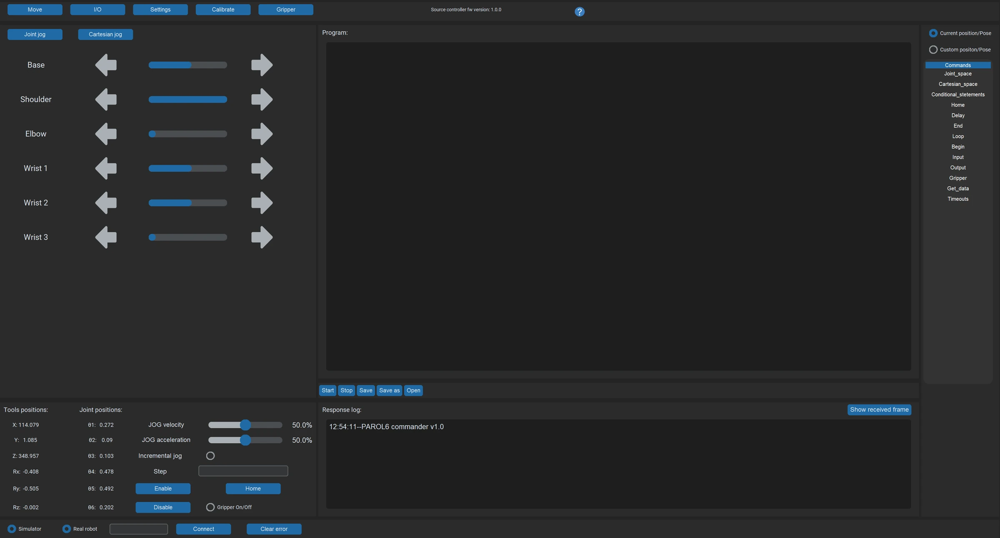

# PAROL6 commander software

**The desktop GUI to jog, program and simulate the PAROL6 robot arm.** Joint and Cartesian jogging, a 3D simulator
that mirrors the robot, a program editor for RBTscript, the I/O and gripper tabs, in a 100 Hz loop to the control
board over USB.

[Documentation](https://docs.source-robotics.com/PAROL-docs/latest/gui/commander/) ·
[Installation](https://docs.source-robotics.com/PAROL-docs/latest/gui/commander/installation/) ·
[Examples](https://docs.source-robotics.com/PAROL-docs/latest/programming/03-commander/examples/) ·
[Discord](https://discord.com/invite/prjUvjmGpZ)

[](https://docs.source-robotics.com/PAROL-docs/latest/gui/commander/installation/)
[](#requirements)
[](https://github.com/Source-Robotics/PAROL-commander-software/blob/main/LICENSE)
[](https://discord.com/invite/prjUvjmGpZ)



> [!CAUTION]
> The [`experimental_kinematics`](https://github.com/Source-Robotics/PAROL-commander-software/tree/experimental_kinematics)
> branch resolves most Cartesian jogging errors but introduces potentially dangerous conditions and may damage the
> robot. Use it at your own risk. The `main` branch is the safe one.

## What it does

- Loop rates of up to 100 Hz, for real-time control
- Joint jogging, and Cartesian jogging in the world reference frame (WRF) and the tool reference frame (TRF)
- Full telemetry data
- Error handling: inverse kinematics errors, joint position limits, speed limits, E-stop
- A response log, a built-in simulator, and a programming interface with simple commands (RBTscript)
- Real-time control of the robot's outputs and reading of its inputs
- Built-in control of the [SSG-48](https://github.com/Source-Robotics/SSG-48-adaptive-electric-gripper) and
  [MSG](https://github.com/Source-Robotics/MSG-compliant-AI-stepper-gripper) electric grippers

It is written in Python with customtkinter and the
[Robotics Toolbox for Python](https://github.com/petercorke/robotics-toolbox-python). It is the tool for the first
day, for teaching poses, for demos and for simple sequences; it has no blending, no collision checking, no network
interface and no tool selection. For programs that need those, the
[Python API](https://github.com/PCrnjak/PAROL6-python-API).

## Requirements

| Requirement | Details |
|---|---|
| Robot | PAROL6 with the [PAROL6 control board](https://source-robotics.com/products/parol6-control-board); [build your own](https://github.com/Source-Robotics/PAROL6-Desktop-robot-arm) |
| Connection | a USB type B cable (USB does not power the board) |
| OS | Windows, Linux or macOS (on macOS, follow the Linux steps) |
| Python | 3.10 or 3.11 (tested on 3.10.12 and 3.11.0; newer versions break some pinned dependencies) |
| PC | one that keeps the 100 Hz loop: at least an Intel i5 six-core processor of 2017 or newer, or an AMD equivalent |

Tested and working systems, from [confirmed_working_systems.md](https://github.com/Source-Robotics/PAROL-commander-software/blob/main/confirmed_working_systems.md):

| System | Processor |
|---|---|
| Windows 10 x64 PC | AMD Ryzen 5 3600, 6 cores, 3600 MHz |
| Windows 10 x64 PC | AMD Ryzen 5 6600HS Creator Edition, 6 cores, 3301 MHz |
| Radxa ROCK 5B, Linux | |
| MacBook Pro, macOS Sonoma 14.3.1 | 2.6 GHz 6-core Intel Core i7 |

## Install

The commander goes into its own folder with its own virtual environment. It pins numpy 1.23.4 and the Python API
needs numpy 2, so the two cannot share one Python.

Windows:

```
git clone https://github.com/Source-Robotics/PAROL-commander-software.git
cd PAROL-commander-software
py -3.11 -m venv .venv
.venv\Scripts\activate
python -m pip install -r requirements.txt
```

Linux and macOS:

```
git clone https://github.com/Source-Robotics/PAROL-commander-software.git
cd PAROL-commander-software
python3.11 -m venv .venv
source .venv/bin/activate
python -m pip install -r requirements.txt
```

On Linux, first `sudo apt install python3.11 python3.11-venv python3.11-tk`; installed into the system Python
without a virtual environment, as in the repository's
[Linux guide](https://github.com/Source-Robotics/PAROL-commander-software/blob/main/Linux_install.md), it also needs
`sudo apt-get install python3-tk` and `sudo apt-get install python3-pil python3-pil.imagetk`. On macOS, use
Python 3.11 from python.org. Activate the
environment again in every new terminal. Every operating system, step by step:
[Installation](https://docs.source-robotics.com/PAROL-docs/latest/gui/commander/installation/) in the PAROL6 manual.

## Quick start

Write the robot's serial port into the program once. Near the top of `GUI/files/Serial_sender_good_latest.py`:

```python
if my_os == "Windows":
    STARTING_PORT = 58 # COM3
else:
    STARTING_PORT = 0
```

On Windows, replace `58` with the number of the robot's port (`5` for `COM5`; Device Manager lists it under
**Ports (COM & LPT)**). On Linux, `0` means `/dev/ttyACM0`. Then start it from the activated environment:

```
cd GUI/files
python Serial_sender_good_latest.py
```

Two windows open: the commander and the simulator. Enter the port at the bottom of the commander (`COM5`, or
`ttyACM0` on Linux) and press **Connect**, more than once if needed. The terminal prints
`Time between 2 commands in ms`: near 0.010 while you jog (the value is in seconds: the 10 ms cycle) means the PC
keeps up. Every window and button: [The GUI](https://docs.source-robotics.com/PAROL-docs/latest/gui/commander/the-gui/).

## Works with

PAROL6 is a high-performance 3D-printed desktop robotic arm, designed to be similar to industrial robots in its
mechanical design, control software and usability. Its control software, GUI and STL files are open source; the
[Build guide](https://docs.source-robotics.com/PAROL-docs/latest/build/) and the
[PAROL6 repository](https://github.com/Source-Robotics/PAROL6-Desktop-robot-arm) have the building instructions,
the STL files and the BOM.

| Product | Firmware | Commander | Repository |
|---|---|---|---|
| PAROL6 desktop robot arm, releases 1.1 and 1 (control board v2.0; v1.2 is functionally identical) | control board firmware 1 | main branch | [PAROL6-Desktop-robot-arm](https://github.com/Source-Robotics/PAROL6-Desktop-robot-arm) |
| SSG-48 adaptive electric gripper, in the Gripper tab | Spectral Micro firmware 101 or newer | main branch | [SSG-48-adaptive-electric-gripper](https://github.com/Source-Robotics/SSG-48-adaptive-electric-gripper) |
| MSG compliant AI stepper gripper, in the Gripper tab | STEPFOC firmware 103 or newer | main branch | [MSG-compliant-AI-stepper-gripper](https://github.com/Source-Robotics/MSG-compliant-AI-stepper-gripper) |

The commander has no releases: the `main` branch is what you clone. Every version that works together:
[Versions and compatibility](https://docs.source-robotics.com/PAROL-docs/latest/appendix/compatibility/) in the
PAROL6 manual. Without the GUI and the simulator, control the robot from Python with the
[Python API](https://github.com/PCrnjak/PAROL6-python-API) (Python 3.11 or newer). One program owns the control
board at a time: the commander and the Python API cannot be connected to the robot together.

## Examples

| Example | What it does |
|---|---|
| [`GUI/files/Programs/example_2.txt`](https://github.com/Source-Robotics/PAROL-commander-software/blob/main/GUI/files/Programs/example_2.txt) | an RBTscript pick and place: joint and Cartesian moves and gripper commands |
| [`GUI/files/Programs/example_dance_2.txt`](https://github.com/Source-Robotics/PAROL-commander-software/blob/main/GUI/files/Programs/example_dance_2.txt) | an RBTscript dance of timed joint and Cartesian moves |
| [`GUI/files/Programs/execute_script.txt`](https://github.com/Source-Robotics/PAROL-commander-software/blob/main/GUI/files/Programs/execute_script.txt) | the program **Start** ran last: Start saves the editor's text here |
| [`Examples/Commander_minimal_version.py.py`](https://github.com/Source-Robotics/PAROL-commander-software/blob/main/Examples/Commander_minimal_version.py.py) | a stripped-down commander without the GUI: `h` homes and `e` enables the robot from the keyboard, and a UDP socket on `127.0.0.1:5001` takes data from other scripts on the PC or network; a base for your own functions (Windows; it also needs the `keyboard` package) |

The language and every command: [RBTscript](https://docs.source-robotics.com/PAROL-docs/latest/programming/03-commander/rbtscript/);
more programs, explained: [Examples](https://docs.source-robotics.com/PAROL-docs/latest/programming/03-commander/examples/).

## Troubleshooting

- **No data after Connect**: press **Connect** again, more than once if needed, and check the port name: `COMx` on
  Windows, `ttyACMx` on Linux ([which tty is my USB device?](https://askubuntu.com/questions/398941/find-which-tty-device-connected-over-usb)).
- **Serial permission error on Linux**: `sudo chmod 666 /dev/ttyACM0` (`0` may be another number, the port the
  robot was given), or join the `dialout` group once: `sudo usermod -aG dialout $USER`, then log out and in.
- **`requirements.txt` fails**: install the packages one by one with the
  [Windows](https://github.com/Source-Robotics/PAROL-commander-software/blob/main/Windows_install.md) or
  [Linux](https://github.com/Source-Robotics/PAROL-commander-software/blob/main/Linux_install.md) guide; the robotics
  toolbox, swift, numpy and scipy are pinned to versions that work together. The
  [Working dependency](https://github.com/Source-Robotics/PAROL-commander-software/tree/main/Working%20dependency)
  folder lists the Python modules of systems on which the software works.
- **The robot stutters**: the PC is too slow for the loop; `Time between 2 commands in ms` often well above 0.010
  shows it ([Communication](https://docs.source-robotics.com/PAROL-docs/latest/08-troubleshooting/communication/)).

## Community

Ask in [Discussions](https://github.com/orgs/Source-Robotics/discussions), chat on
[Discord](https://discord.com/invite/prjUvjmGpZ), report a bug in
[Issues](https://github.com/Source-Robotics/PAROL-commander-software/issues). Follow Source Robotics:

[](https://discord.com/invite/prjUvjmGpZ)
[](https://github.com/orgs/Source-Robotics/discussions)
[](https://www.youtube.com/@source-robotics)
[](https://www.instagram.com/source_robotics/)
[](https://x.com/SourceRobotics)
[](https://www.linkedin.com/company/source-robotics/)
[](https://source-robotics.com/blogs/blog)

## Safety, liability and disclaimer

1. The software is still in development and may contain bugs, errors, or incomplete features.
2. Users are encouraged to use this software responsibly and at their own risk.

## Licensing

Project is under [GPLv3 Licence](https://github.com/Source-Robotics/PAROL-commander-software/blob/main/LICENSE).
